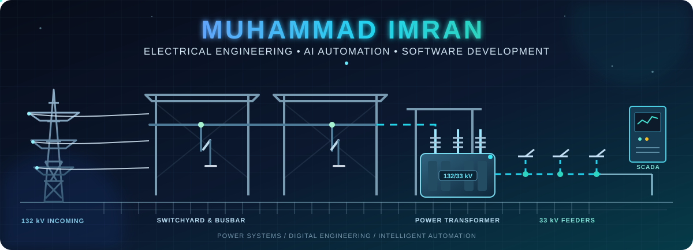

### ⚡ Electrical Engineer | 🤖 AI & Automation Builder | 💻 Software Developer

**14+ years in Oil & Gas Electrical Operations · 132/33 kV Substations · Building AI-Powered Tools**

Custom animated engineering illustration — stylized, conceptual (not an operational single-line diagram)

---

## 👨‍💻 About Me

I'm **Muhammad Imran**, an electrical engineering professional with **14+ years of practical experience** in the **oil & gas sector**, including HV/MV substation operations, troubleshooting, protection systems, commissioning, transformer testing, and field maintenance.

Alongside electrical engineering, I develop and explore **software products, AI automation, networking, and modern web applications**. My goal is to connect **industrial engineering knowledge with useful digital solutions**.

- ⚡ **Electrical focus:** 132/33 kV substations, switchgear, protection relays, SCADA, transformers & MV distribution
- 🧮 **Power system software:** ETAP, PSCAD, DIgSILENT PowerFactory, Siemens DIGSI 5, AutoCAD Electrical
- 🌐 **Networking:** CCNA studies, Cisco Packet Tracer and practical network fundamentals
- 🤖 **AI automation:** Local LLMs, Ollama, n8n, Python, agent workflows and Docker
- 💻 **Software:** Python, TypeScript, JavaScript, React, Next.js, FastAPI, PostgreSQL, Git & Linux
- 🎓 **Education:** DAE Electrical and BS Computer Science
- 📍 **Location:** Oman | Originally from Pakistan

> **From high-voltage power systems to intelligent software — designing practical solutions for real-world challenges.**

## 🧰 Engineering Software & Industry Expertise

| Domain | Experience & Tools |
| :--- | :--- |
| ⚡ **HV/MV systems** | 132/33 kV substations, 33 kV overhead lines, switchgear, transformer operations |
| 🛡️ **Protection & relays** | Overcurrent & earth fault, differential & distance protection; Siemens SIPROTEC, ABB relays, DIGSI 5 |
| 📈 **Power system studies** | ETAP, PSCAD, DIgSILENT PowerFactory, load flow and protection coordination concepts |
| 🔬 **Electrical testing** | Transformer IR, ratio testing, winding resistance, cable testing, thermography |
| 🏭 **Industrial operations** | SCADA monitoring, fault investigation, preventive maintenance, operational safety |
| 📐 **Engineering design** | AutoCAD Electrical, drawings, single-line diagrams and technical documentation |

## 💻 Programming, AI, Networking & Development

**Programming & Web**

**Infrastructure & Automation**

**Networking & Simulation**

## 🚀 Selected Public Projects

<table>
<tr>
<td width="50%" valign="top">

### ⚡ [Electrical Engineer Pocket](https://github.com/fitpros/Electrical-Engineer-pocket)

Android engineering toolkit for electrical calculations and field-oriented reference workflows.

**Electrical Engineering · Android**

</td>
<td width="50%" valign="top">

### 🧰 [Image Compressor](https://github.com/fitpros/image-copressor)

An image-processing utility focused on simple, practical file optimization.

**Developer Tools · Image Utilities**

</td>
</tr>
<tr>
<td width="50%" valign="top">

### 📄 [WeLovePDF](https://github.com/fitpros/welovepdf)

A project exploring document productivity and PDF utilities.

**PDF Tools · Productivity**

</td>
<td width="50%" valign="top">

### 🌐 [My Portfolio](https://github.com/fitpros/imran-portfolio)

My personal portfolio repository, showcasing my evolving engineering and technology journey.

**Web · Professional Portfolio**

</td>
</tr>
</table>

> Additional applications in AI automation, developer tooling and fleet/operations software are under active development in private repositories.

## 📊 GitHub Activity

## 🎯 Current Focus

- ⚡ Strengthening **power system protection** and analysis with ETAP, PSCAD, PowerFactory and DIGSI 5
- 🌐 Learning **CCNA fundamentals** with Cisco Packet Tracer
- 🤖 Designing practical **AI automation and agent workflows** using local models and n8n
- 🛠️ Building **engineering and developer productivity applications**
- 📚 Combining industry field experience with computer science and structured learning

## 🤝 Connect

I'm open to conversations about **electrical power systems, relay protection, industrial automation, AI agents, networking and software engineering**.

**⚡ Electrical Engineering × 🤖 AI Automation × 💻 Software Development**

Made with engineering discipline, curiosity and continuous learning.

